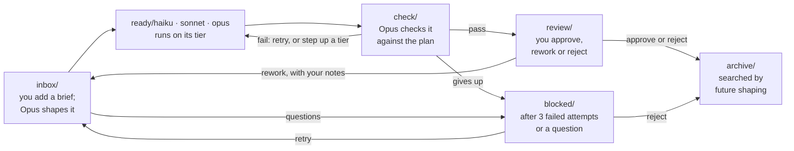

# Git work queue: design

7 November 2026 · David

## Summary

A git repo holds every work item as a folder, and the folder it sits in is its state. A runner script, started by systemd timers on one Linux VM, moves items from stage to stage and calls Claude Code in headless mode (`claude -p`) to do the thinking at each step.

- Opus shapes each new item into a plan and picks the model tier (Haiku, Sonnet or Opus) to do it.
- A runner per tier carries out plans and writes results into the item folder.
- Opus checks the result against the plan's acceptance criteria.
- You review; approved items move to `archive/`, where later shaping runs can find them.

The agents only read and write files. The runner does all git work and all state moves, so the state machine stays plain code you can read and test. The same design runs on GitHub (home) and Azure DevOps (work); only the remote URL, the git credential and the Claude credential differ.

Scope is knowledge work: research, analysis and writing. Coding stays in Claude Code, in its own repos, outside this system.

## Lifecycle

An item's state is the folder it sits in. The runner moves it with `git mv` and commits, so `git log` on an item folder is its full history.



You act at `inbox/`, `review/` and `blocked/`. Everything else happens in the overnight shift. Failed checks loop back to `ready/`; your rework notes loop back to shaping, because feedback often changes the plan, not just the result.

## Repo layout

One queue repo per instance (home, work), holding stage folders, prompts and a `CLAUDE.md` of house rules every agent reads. The runner code is installed separately to `/opt/workq` on the VM, so no agent can edit the code that governs it.

```
workq-queue/
├── CLAUDE.md              # house rules every agent reads
├── README.md              # how to add work and review it
├── prompts/
│   ├── shape.md
│   ├── execute.md
│   └── check.md
├── inbox/
├── ready/haiku/  ready/sonnet/  ready/opus/
├── check/
├── review/
├── blocked/
└── archive/
    ├── INDEX.md
    └── 2026-11/
```

Each item is a folder named `2026-11-07-short-slug`. To add one, create `inbox/<anything>/brief.md` (or just `inbox/<anything>.md`) from the GitHub or Azure DevOps web page, or run `workq add "title"`. The runner renames the folder to the dated form at the start of shaping.

| File | Written by | Holds |
| --- | --- | --- |
| `brief.md` | You | What you want, links, pasted data; any files sit beside it |
| `meta.yaml` | Runner only | ID, title, stage history, tier, an attempt count for each stage, runs, estimated cost |
| `notes.md` | Runner only | Your review notes from earlier rounds, newest last |
| `plan.md` | Shaper | Tier and reason, steps, acceptance criteria, expected outputs, tool list, turn and spend limits |
| `questions.md` | Shaper | Questions for you when the brief can't be planned |
| `result.md` | Executor | What was done, where the outputs are, loose ends; the first line is a one-sentence summary |
| `out/` | Executor | Any other files produced |
| `check.md` | Checker | Pass or fail, with a line per criterion |
| `review.md` | You | `approve`, `rework` or `reject` (`retry` or `reject` in `blocked/`), plus notes |
| `log/` | Runner | Raw JSON output of each Claude run (cost, turns, time), and earlier `check.md` files |

The front of `plan.md` is machine-read, so the runner can route and limit the run without trusting prose:

```yaml
---
tier: sonnet
reason: several sources to compare, clear question, no judgement calls left open
max_turns: 40
budget_usd: 2.00
tools: [Read, Write, Edit, Glob, Grep, WebSearch, WebFetch]
---
## Goal
## Approach
## Steps
## Acceptance criteria
## Outputs
```

## Runner

One script does everything: `workq run <stage>` runs one stage once; `workq night` loops the stages through the overnight shift; `workq digest` sends the morning email. It is one Python 3 file (standard library plus PyYAML), since reading front matter and YAML in bash breaks easily.

Each stage run does this:

1. **Lock.** Take a `flock` for the stage, so two runs of one stage never overlap.
2. **Sync.** Each stage has its own clone under `/var/lib/workq/clones/<stage>/`. `git fetch`, then `git reset --hard origin/<branch>` and `git clean`, so every run starts clean. The branch is `main`, or `queue` where org policy forces pull requests.
3. **Pick.** Oldest item in the stage folder (folder names sort by date). One item per run.
4. **Check caps.** Skip if tonight's run count or estimated spend for this tier is over its cap (summed from the runner's ledger on the VM).
5. **Claim.** Add one to the stage's own attempts field in `meta.yaml`, record the start time, commit and push. Each stage has its own field (`shape_attempts`, `execute_attempts`, `check_attempts`), so one pass through all three doesn't use up an item's three tries; a replan adds to `shape_attempts`. If the run then crashes, the attempt still counts, so a broken item can't loop forever. If the run stops on a usage limit, or Claude can't start at all, the runner gives the attempt back.
6. **Run Claude.** `claude -p` with the stage prompt, model, tool list and limits (see Claude Code setup). Save its JSON output to the item's `log/`.
7. **Guard.** `git status --porcelain`: any change outside the item folder, or to `meta.yaml`, or to a file the stage does not own, is thrown away and the run counts as failed. Then check the stage's required file is new and parses (for example, `plan.md` names a valid tier). Shape owns `plan.md` and `questions.md`; execute owns `result.md` and `out/`; check owns `check.md`.
8. **Move.** `git mv` to the next folder by outcome, update `meta.yaml`, commit as `workq: <id> check: passed (check passed)`.
9. **Push.** If the push is rejected because one of your own edits landed first, `git pull --rebase` and retry, up to three times. You and the runner touch different files, so rebases don't clash.

The agents never run git. Their tool lists leave it out, and step 7 catches it if they try.

There are no "in progress" folders. With one VM and one lock per stage, two workers can't hold the same item. If a second VM is ever added, the claim commit in step 5 becomes the lock: write `claimed_by` in `meta.yaml`, and a rejected push means someone else got there first.

## Stages

You only ever edit two files: `brief.md` to ask for work and `review.md` to decide on it. Everything else is written by agents or the runner.

### Shape (Opus)

Reads `brief.md`, `notes.md` and any earlier plan, result and check, searches `archive/` for related past items, and writes `plan.md`. The acceptance criteria matter most, because they are what the checker tests against. For knowledge work they must be checkable claims ("names three options, each with a source"), not qualities ("thorough analysis").

- Plan written → `ready/<tier>/`
- Brief too unclear → writes `questions.md`, item → `blocked/`
- Too big for one item → proposes how to split it in `questions.md`, item → `blocked/` (automatic splitting can come later)

Tier rules, written into `prompts/shape.md`:

| Tier | Use when | Examples |
| --- | --- | --- |
| Haiku | Mechanical, fully specified, one or two steps, easy to check | Reformat a file, pull fields from a document, summarise one given file |
| Sonnet | The default: several steps, clear goal, ordinary judgement | Answer a set research question, turn notes into a report, compare named options against set criteria |
| Opus | Open choices, high stakes, much to hold in mind at once, or a lower tier already failed | Weighing options with no clear answer, advice others will act on, anything where a wrong answer is costly and hard to spot |

When torn between two tiers, the shaper picks the lower one only if the acceptance criteria are tight enough for the checker to catch a miss.

### Execute (Haiku, Sonnet or Opus)

One stage per `ready/` subfolder. It reads `plan.md` plus `notes.md` and any earlier `check.md`, and writes `result.md` and `out/`. It may not change `plan.md`. If it finds the plan is wrong, it sets `replan: true` in the front matter of `result.md` and the item goes back to `inbox/`.

### Check (Opus)

Reads the brief, plan, result and outputs. Spot-checks the facts and sources the criteria name, and the arithmetic. It judges; it does not fix. Writes `check.md` with `verdict: pass` or `fail` in its front matter and a line per criterion.

On a fail:

1. First fail: retry at the same tier, with the checker's notes.
2. Second fail: move up a tier (Haiku → Sonnet → Opus).
3. Opus fails, or three execute attempts used: `blocked/`.

### Review (you)

Each morning's digest email lists what is in `review/` and `blocked/`. You read `result.md` and `out/` in the web UI, then add `review.md`. It needs a `verdict:` line; notes for the next round go below it:

```
verdict: rework
Add a cost comparison over five years, not three.
```

| Folder | Verdicts |
| --- | --- |
| `review/` | `approve` (to `archive/`), `rework` (to `inbox/` with your notes), `reject` (to `archive/`, marked rejected) |
| `blocked/` | `retry` (to `inbox/` with your notes; edit `brief.md` first if the shaper had questions), `reject` |

A stage with no AI, `file`, acts on these at the start of each night's shift, or on demand with `workq run file`. A rework or retry resets the item's attempt counts.

An option, not in v1: a pull request per item gives a better diff and comment view, and one-tap approval in the GitHub app, at the cost of a branch per item and API calls through `gh` and `az repos`. Start with the file; switch if it feels clumsy.

### Archive

Plain folders by month. The `file` stage adds one line per item to `archive/INDEX.md` (date, title, tier, runs, estimated cost, outcome), which gives the shaper a cheap list to search before reading whole folders.

## Scheduling

Everything runs in one overnight shift, every day, from 22:00 to 06:00 Perth time, followed by a digest email. A brief you add during the day comes back in the next morning's email. The window is set per instance.

One timer starts `workq night` at 22:00. It runs the stages in order, one at a time:

1. `file`: act on any `review.md` you wrote during the day.
2. `shape`: plan everything in `inbox/`.
3. `exec-haiku`, `exec-sonnet`, `exec-opus`: work through `ready/`.
4. `check`: check everything in `check/`.
5. Go round again, so failed checks get their retry the same night. Stop when a full pass moves nothing, a cap is reached, or it is 06:00. No run starts if its time limit would carry it past 06:00, so the shift is over before the digest goes out.

Each run keeps its own hard time limit, from 15 minutes for `shape` to 60 for `exec-opus`. If a run hits the subscription's usage limit, the shift sleeps until the limit resets, if that falls before 06:00, then carries on. If Claude can't start or can't sign in, the shift stops, so a bad token doesn't push every item into `blocked/`.

One stage at a time keeps it simple: no two runs ever share the repo, so the runner's push retries only matter when your daytime edits land mid-push.

A second timer sends the digest at 06:30. Set the VM's time zone to `Australia/Perth` (`timedatectl set-timezone Australia/Perth`): the timers use the system clock. One template service covers both:

```ini
# /etc/systemd/system/workq@.service
[Unit]
Description=workq %i
After=network-online.target
Wants=network-online.target

[Service]
Type=oneshot
User=workq
Group=workq
Environment=WORKQ_CONFIG=/etc/workq/config.yaml
ExecStart=/opt/workq/bin/workq %i
TimeoutStartSec=8h30min
Nice=10
```

```ini
# /etc/systemd/system/workq-night.timer
[Timer]
OnCalendar=*-*-* 22:00
Unit=workq@night.service
Persistent=false

[Install]
WantedBy=timers.target

# /etc/systemd/system/workq-digest.timer is the same, with
# OnCalendar=*-*-* 06:30 and Unit=workq@digest.service
```

`Persistent=false` means a VM that was off at 22:00 skips that night, rather than starting a shift mid-morning and eating into your daytime allowance.

Controls:

- **Pause:** a `PAUSE` file at the repo root stops the shift. You can add or delete it from your phone in the web UI, or with `workq pause` and `workq resume`.
- **Spend:** set per instance, in that instance's `/etc/workq/config.yaml`: a nightly cap in estimated dollars and in runs, split by tier. Shape and check count as Opus. On a subscription the dollar figure is only Claude Code's estimate, so the run count is the firmer limit. A per-run cap comes from `plan.md`, clamped to a ceiling per stage so the shaper can't grant itself a large budget.
- **Run outside the window:** `sudo systemctl start workq@night` runs a shift on demand; `sudo -u workq workq run check` runs one stage once.

### Digest email

Sent every morning even when there is nothing to report, so no email means something broke. Plain text, built by the runner with no AI:

- **For review:** title, tier, how long it has waited, first line of `result.md`, link to the folder
- **Blocked:** title, the reason, and the shaper's questions if any
- **Problems:** failed runs, rejected pushes, caps or usage limits hit, bad review verdicts (repeats grouped)
- **Last night:** runs per tier and estimated spend against the caps, and outcomes

Sent with any command that reads a whole message on stdin; the default is `msmtp -t`, configured in the `workq` user's `~/.msmtprc` (owner `workq`, mode 600: msmtp refuses a password file others can read). At home that goes through your mail provider. At work, Microsoft 365 is switching password sign-in for SMTP off by default for existing tenants at the end of December 2026, so expect OAuth, a Graph app or an IP-based relay, by whatever method IT sets ([timeline](https://www.captaindns.com/en/blog/microsoft-exchange-basic-auth-smtp-end)). Links open the folder in the GitHub or Azure DevOps web UI, so you can read results and add `review.md` from your phone.

## Claude Code setup

Each run is one `claude -p` call: no chat, it does the task and exits. Claude Code reads `CLAUDE.md` from the repo root on its own, so house rules live there and stage rules go in through `--append-system-prompt`. The task itself goes in on stdin: `--tools` and `--allowedTools` take a list and would swallow a prompt placed after them.

```bash
cd /var/lib/workq/clones/exec-sonnet
printf 'Stage: execute\nWork item folder: ready/sonnet/%s\n' "$ID" | \
sudo -n -H -u workq-agent /opt/workq/bin/agent-claude -p \
  --model sonnet \
  --output-format json \
  --permission-mode dontAsk \
  --no-session-persistence \
  --max-turns 40 \
  --max-budget-usd 2.00 \
  --append-system-prompt "$(cat prompts/execute.md)" \
  --restricted \
  --tools Read,Write,Edit,Glob,Grep,WebSearch,WebFetch \
  --allowedTools Read Write Edit Glob Grep WebSearch WebFetch
```

The runner builds and runs this itself, with a hard timeout, and saves the JSON output to the item's `log/`. What each guard does:

- `--model` takes the aliases `haiku`, `sonnet` and `opus`, so tier maps straight to a flag. Full model IDs in the config's `models:` section pin a tier to a known model.
- `--permission-mode dontAsk` refuses any tool not on the allow list rather than waiting for a prompt nobody will answer. Don't use `--dangerously-skip-permissions`.
- `--restricted` keeps the file tools inside the working folder and ignores user and project settings files.
- `--tools` sets which tools exist at all; `--allowedTools` approves them (and narrows `Bash` to named commands).
- `--max-turns` and `--max-budget-usd` stop runaway runs; both work only in print mode. The budget is Claude Code's own estimate, so the nightly run cap in the runner is the real backstop.
- `--output-format json` returns the result with cost and turn count, which is what the runner logs.
- Leave out `--fallback-model`: it would quietly run a tier on a different model, which defeats the routing.

Tools by stage (the runner clamps whatever `plan.md` asks for to the stage's ceiling):

| Stage | Allowed tools |
| --- | --- |
| Shape | `Read Glob Grep Write Edit` |
| Execute | From `plan.md`, within: file tools, `WebSearch`, `WebFetch`; `Bash` only for commands named in the config's `bash_allow`, such as `python3 *` for data work |
| Check | `Read Glob Grep Write Edit`, plus `WebFetch` to check sources |

`allow_web: false` in the config removes the web tools from every stage.

### Credentials

Keep credentials away from the agent. Claude runs as a second Linux user, `workq-agent`, sharing a group with `workq` so both can write the clones.

- `workq` runs the queue, holds the git key in `/home/workq/.ssh`, and does all git work. Its home is mode 700.
- `workq-agent` holds only its Claude credential, in `/etc/workq/agent.env` (owner `workq-agent`, mode 600), which the runner can't read.
- A sudo rule lets `workq` start one program as `workq-agent`: `/opt/workq/bin/agent-claude`. That wrapper loads the agent's credential and starts Claude, and nothing else.
- `/etc/claude-code/managed-settings.json` denies reads of `/etc/workq`, `/home/workq` and the runner's ledger, and the agent can't override it.

The credential itself:

- **Home:** a setup token from `claude setup-token` on a personal subscription, in `CLAUDE_CODE_OAUTH_TOKEN`, or an Anthropic API key in `ANTHROPIC_API_KEY`.
- **Work:** Perenti's Claude Team subscription, through `claude setup-token` run once as the person whose seat it uses. Three catches. Runs draw on that seat's five-hour and weekly allowance, which it shares with that person's own Claude use. The cost figure in the JSON output is notional, not a bill. And IT should confirm that unattended use of a seat is allowed, and whether it needs a seat of its own.

When a run stops on a usage limit, the runner gives the attempt back and the shift waits for the reset rather than counting a failure. The agent can still read its own Claude token; the egress firewall under Risks and guards is the backstop for that. See the [CLI reference](https://code.claude.com/docs/en/cli-reference) and [how plan limits work](https://dev.to/aobaworks/claude-code-rate-limit-reached-retry-setup-for-cron-jobs-1ioi).

## GitHub and Azure DevOps

The runner speaks plain git, so the two differ only in setup. Run them as two separate instances: separate VMs if you can, and at the least separate Linux users, keys, config files and Claude credentials. Work data should never pass through the home credential or the home repo.

| | GitHub (home) | Azure DevOps (work) |
| --- | --- | --- |
| Remote | `git@github.com:<you>/workq-queue.git` | `git@ssh.dev.azure.com:v3/<org>/<project>/workq-queue` |
| Web links | `https://github.com/<you>/workq-queue/tree/main` | `https://dev.azure.com/<org>/<project>/_git/workq-queue?version=GBmain&path=` |
| Git credential | Deploy key with write access, scoped to this one repo | SSH key on a service account, or a PAT with Code read and write. PATs expire, so note the date |
| Branch rules | None needed on a private repo | The runner must push straight to its branch. If org policy forces pull requests on every `main`, use a `queue` branch |
| Claude access | Personal setup token or API key | Team subscription seat, through a setup token |
| Notices | Daily digest email through your mail provider | Daily digest email through Microsoft 365, method set by IT |
| Where the VM runs | Home server | Where IT says |

## Risks and guards

The main risk is an agent acting on text it reads, such as instructions hidden in a pasted email or a fetched page. The design answers this by keeping agents away from git, secrets and anything outside their item folder.

| Risk | Guard |
| --- | --- |
| Hidden instructions in a brief or fetched page | No git, credentials held by a different Linux user, short tool lists, web tools only when the plan needs them; you review before anything is filed |
| Agent edits prompts, `CLAUDE.md` or another item | Runner throws away any change outside the stage's own files and fails the run |
| Runaway spend | Turn and budget caps per run, nightly caps per tier, `PAUSE` file |
| Shift uses up the seat's weekly allowance and locks you out by day | Nightly run cap sized to leave room for your own use. Scripts can't read plan usage, so watch it on claude.ai for the first few weeks |
| Hung run | Per-run timeout plus systemd `TimeoutStartSec`; the attempt was counted at claim |
| Item that never passes | Three attempts per stage, then `blocked/` |
| Claude can't start or sign in | Attempt given back, shift stopped, reported in the digest |
| Leaked repo credential | Deploy key or PAT scoped to this one repo, readable only by `workq`; neither user has sudo beyond the one wrapper |
| Data sent out of the VM | Optional egress firewall: allow only the git host and the Claude endpoint |
| Repo bloat from large outputs | Runner rejects an `out/` folder over a size limit (20 MB by default); use Git LFS if binary outputs become normal |
| Your edit and a runner push collide | Different files, so rebase merges them; on a true clash the runner leaves that item for the next pass |

Two habits matter more than any guard. Never put passwords or keys in a brief, because git keeps them forever. And read the costs in the digest after the first 20 or so items: Opus runs at least twice per item (shape and check), which for small jobs may cost more than the work itself.

## Build plan

Build at home first, run each stage by hand before any timer exists, and add the work instance last.

1. **Skeleton.** Repo, folders, `CLAUDE.md`, the three prompts, and the runner with only the `shape` and `file` stages, run by hand.
   - Done when five real briefs come back with plans and tiers you agree with.
2. **Execute and check.** Add the three `exec-*` stages and `check`, still run by hand.
   - Done when items reach `review/` with no hand-run git, and a deliberately bad result gets failed.
3. **Unattended.** systemd timers, caps, `PAUSE`, digest email. Run for two weeks.
   - Done when you have cost and run-time data, and have tuned caps and tier rules from it.
4. **Work instance.** Separate VM, Azure DevOps repo, Team seat token once IT has confirmed its use.
   - Done when IT has signed off and the first work item reaches `archive/`.

## Decisions

| Question | Decision, 7 Nov |
| --- | --- |
| Kind of work | Knowledge work. Coding stays in Claude Code in separate repos |
| Review method | Edit `review.md` for now |
| Spend ceiling | Nightly, set per instance |
| Claude access at work | Perenti's Claude Team subscription |
| Schedule | One overnight shift every day, 22:00 to 06:00 |
| Notices | One digest email each morning |

## Still open

- [ ] IT to confirm unattended use of a Team seat is allowed, whether it needs its own seat, and how the VM should send mail through Microsoft 365 once password sign-in for SMTP is off.

## Points against

- **You may not need a VM.** Scheduled GitHub Actions and Azure Pipelines can both run `claude -p`. The runner logic stays the same and there is one less machine to patch. The VM wins on long runs and on keeping work data where IT can see it.
- **Git is a clumsy queue.** GitHub Issues and Azure Boards already have states, comments and phone apps. Git earns its place as the archive and as files agents can read; the queue itself could live in the tracker.
- **Opus shaping may not pay for itself.** Opus runs twice on every item, even a five-minute Haiku job. Sending everything to Sonnet with an instruction to hand back anything beyond it may cost less for the same results. Measure before you commit to it.
- **Opus checking Opus shares Opus's blind spots.** The check earns most on Haiku and Sonnet work. On Opus items, your review is the real check.
- **A check that nearly always passes teaches you to skim.** Decide now what you will always read at review, whatever the checker said.
